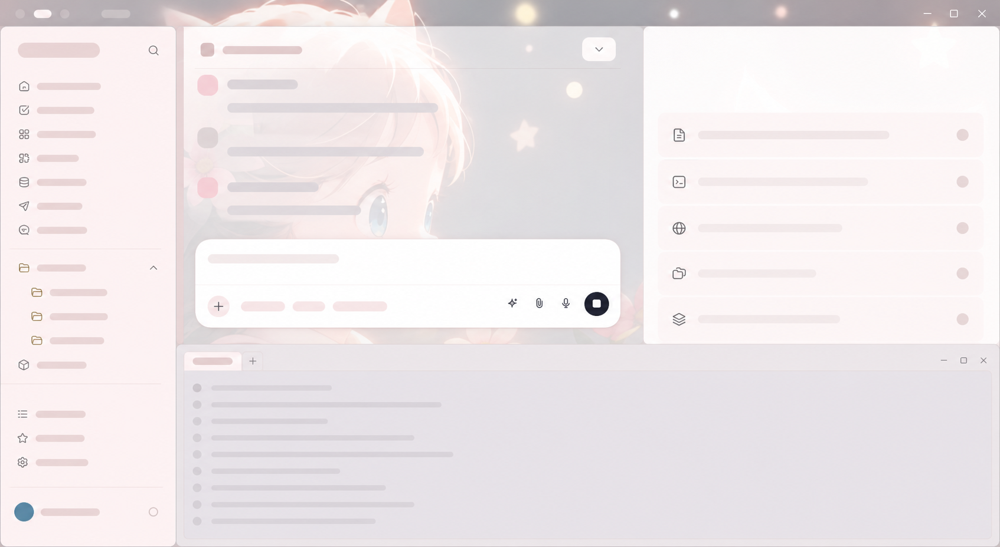

# Codex Portrait Interface

An unofficial Codex skill for applying a readable desktop theme or an experimental, image-derived visual skin to the real Codex desktop app.

> This project is independent of OpenAI and Microsoft. It is not endorsed by either company, does not distribute Codex, and never modifies the Microsoft Store installation.

## Example result



_Sanitized illustrative layout-copy example. It uses non-readable placeholder content and is included to demonstrate the visual treatment only; it is not an official Codex screenshot or product claim._

The example demonstrates the intended composition:

- The supplied image remains visually present in the centre workspace, rather than becoming a full-window wallpaper.
- Left navigation, file-tree states, composer, right inspector, and bottom panel inherit related light, readable surfaces.
- Native controls and icons remain native; the skill adjusts scoped colour states instead of replacing interactive UI.

## What it does

| Mode | Scope | Status |
| --- | --- | --- |
| Theme mode | Uses supported Codex appearance settings for colours, fonts, code, and contrast. | Stable |
| Layout-copy mode | Builds a separate, version-locked user copy with a passive, image-derived background treatment. | Experimental: Windows 10/11 + tested Microsoft Store Codex only |

Layout-copy keeps native controls and SVGs intact. It only adds a pointer-inert, `aria-hidden` decorative layer and visual tokens for navigation, composer, panels, menus, code, terminal, and diff surfaces. It leaves `C:\Program Files\WindowsApps` unchanged.

## Before you use it

- Read [Safety model](docs/safety-model.md), [privacy](docs/privacy.md), and [compatibility](docs/compatibility.md).
- Own the right to use any background image. Do not use or publish private images without permission.
- Treat layout-copy as a local experiment. A Codex update requires a rebuild and may require an updated compatibility profile.
- Do not run it from an untrusted clone. It packages a local user-scoped application copy.

## Install the skill locally

Clone this repository, then copy only the skill payload into your Codex skills directory:

```powershell
git clone https://github.com/zheng21sdsd/codex-portrait-interface.git
Set-Location .\codex-portrait-interface
.\scripts\install-skill.ps1 -SourcePath .\skills\codex-portrait-interface
```

The installer refuses to overwrite an existing skill unless you add `-Force`; it moves the old skill aside instead of deleting it. Restart Codex after installation so it can discover the skill.

Alternatively, copy [`skills/codex-portrait-interface`](skills/codex-portrait-interface) into `%USERPROFILE%\.codex\skills\codex-portrait-interface` manually.

## Set up local dependencies

The dependencies are deliberately local and locked. No `npx` download runs during packaging.

```powershell
Set-Location $env:USERPROFILE\.codex\skills\codex-portrait-interface
npm ci
py -3 -m pip install -r requirements.txt
node scripts\codex-layout-copy.mjs doctor --json
```

`doctor` is read-only. It checks the Store package, the pinned archive tool, Pillow, platform, and tested compatibility.

## Example workflow

For a supported theme-only change, invoke the skill in Codex and supply a theme JSON. Theme mode does not insert an image.

For the experimental image mode, first run a no-write check, then install only after it succeeds:

```powershell
node scripts\codex-layout-copy.mjs install --background "C:\path\to\background.webp" --dry-run --json
node scripts\codex-layout-copy.mjs install --background "C:\path\to\background.webp" --json
node scripts\codex-layout-copy.mjs verify --json
```

Close ordinary Store Codex before opening **Codex Personal** from the Start menu. The normal Store shortcut always remains unmodified.

| Step | What you should see |
| --- | --- |
| `doctor` | A read-only `ready` result with the tested Store version and local dependencies. |
| `install --dry-run` | A derived, readable image palette without modifying the local app copy. |
| `install` | A separate **Codex Personal** Start menu entry; the Store installation stays unchanged. |
| `verify` | Archive, passive-skin, contrast, and isolated renderer checks. Visual approval still belongs to you. |

## Update and rollback

After updating this repository, reinstall the skill, run `npm ci`, then run `doctor` before rebuilding the experimental copy. If `doctor` says the Store version is untested, wait for a compatible release rather than using `--allow-unsupported-version` casually.

```powershell
node scripts\codex-theme.mjs rollback --json
node scripts\codex-layout-copy.mjs rollback --json
```

Theme rollback is hash-guarded: it refuses to overwrite settings changed since the apply step unless you explicitly pass `--force`. Layout rollback removes only a shortcut it can prove it created, then removes its guarded user-scoped copy.

## Privacy and troubleshooting

The original image is not retained in the install manifest. A metadata-free PNG derivative is placed in the local experimental copy, so the visual pixels remain local until you remove that copy. Verification normally removes its isolated profile and log. See [privacy](docs/privacy.md) and [troubleshooting](docs/troubleshooting.md) before filing an issue.

Never attach a Codex profile, `manifest.json`, runtime log, private screenshot, app archive, or unredacted background image to a public issue.

## Contributing and security

See [CONTRIBUTING.md](CONTRIBUTING.md), [SECURITY.md](SECURITY.md), [SUPPORT.md](SUPPORT.md), and the [Code of Conduct](CODE_OF_CONDUCT.md). The published source is licensed under [MIT](LICENSE); third-party and trademark notices are in [NOTICE.md](NOTICE.md).
